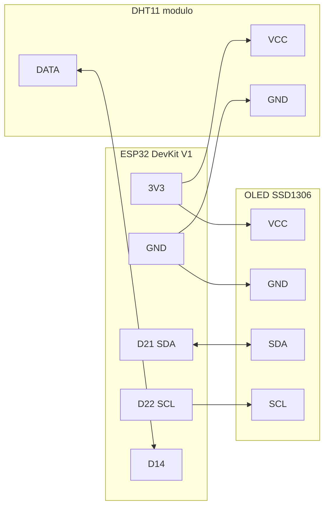
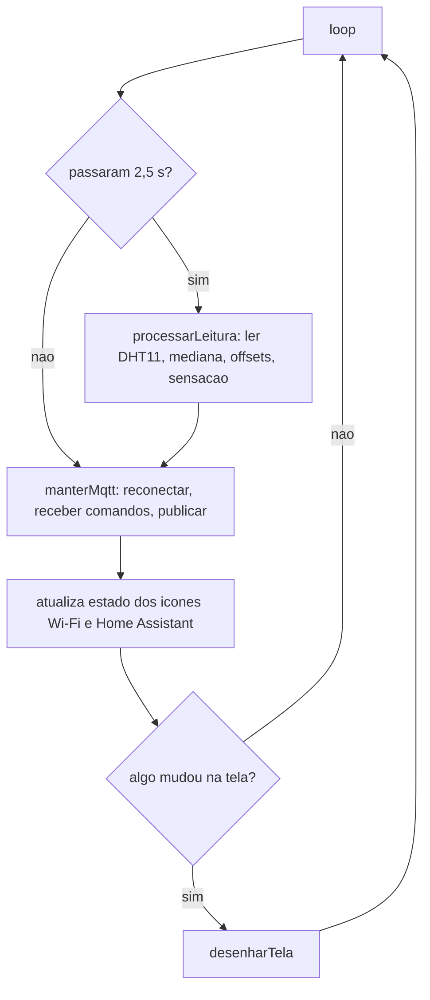
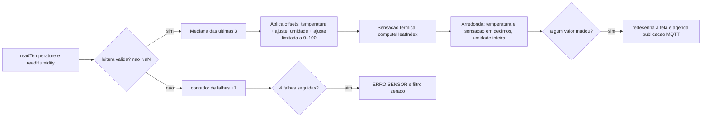
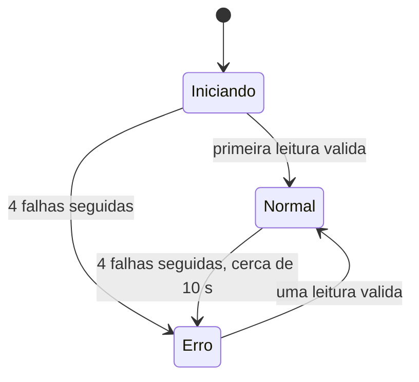
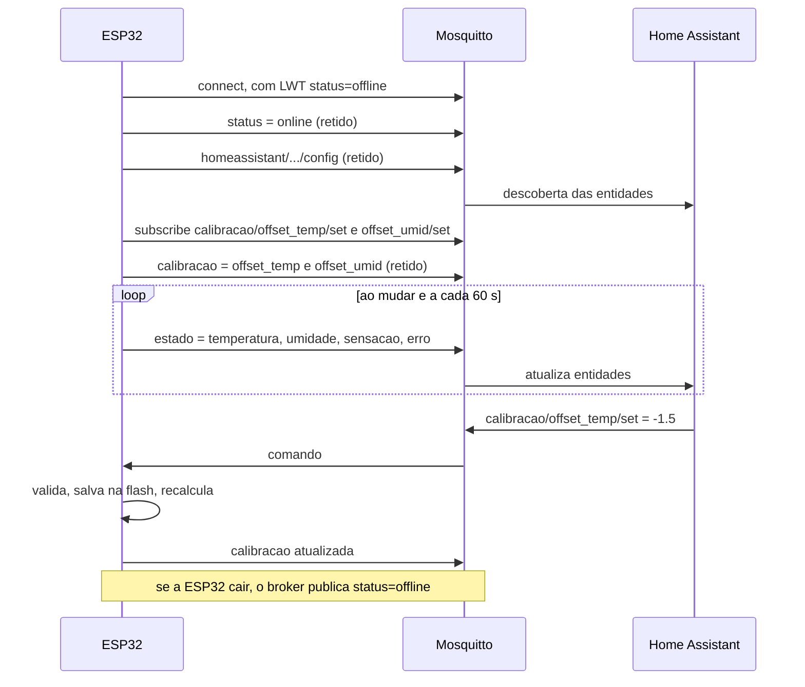

# TempHumid

Termômetro e higrômetro com **ESP32**, sensor **DHT11** e display **OLED SSD1306**, integrado ao **Home Assistant** via **MQTT** com descoberta automática.

A temperatura, a umidade e a sensação térmica são exibidas localmente no display (com um termômetro gráfico) e publicadas no Home Assistant, onde também é possível **ajustar o offset de temperatura e de umidade** sem regravar a firmware.

---

## Sumário

- [Funcionalidades](#funcionalidades)
- [Hardware](#hardware)
- [Ligações](#ligações)
- [Arquitetura do firmware](#arquitetura-do-firmware)
- [Processamento da leitura](#processamento-da-leitura)
- [Integração com o Home Assistant](#integração-com-o-home-assistant)
- [Instalação](#instalação)
- [Calibração](#calibração)
- [Simulação no Wokwi](#simulação-no-wokwi)
- [Parâmetros ajustáveis](#parâmetros-ajustáveis)
- [Solução de problemas](#solução-de-problemas)
- [Estrutura do repositório](#estrutura-do-repositório)
- [Limitações conhecidas e próximos passos](#limitações-conhecidas-e-próximos-passos)

---

## Funcionalidades

- **Temperatura, umidade e sensação térmica**: a sensação térmica é o índice de calor (*heat index*) calculado a partir da temperatura e da umidade já ajustadas.
- **Leitura estável**: filtro de mediana das últimas 3 leituras, que elimina leituras espúrias isoladas do DHT11.
- **Respeita o limite do sensor**: uma leitura a cada 2,5 s (o DHT11 aceita no máximo 1 por segundo).
- **Detecção de falha do sensor**: após 4 leituras inválidas seguidas (~10 s), a tela mostra `ERRO SENSOR` e o Home Assistant é notificado; os valores passam a "desconhecido" em vez de congelar no último valor.
- **Loop não bloqueante**: leitura, tela e rede rodam em paralelo via `millis()`; a tela só é redesenhada quando algo muda.
- **Home Assistant via MQTT Discovery**: o dispositivo e suas entidades aparecem sozinhos, sem YAML.
- **Calibração remota**: offsets de temperatura (±10 °C) e umidade (±20 %) editáveis no Home Assistant e salvos na flash da ESP32.
- **Funciona offline**: sem Wi-Fi ou sem broker, a leitura e o display continuam operando normalmente.
- **Simulação**: projeto pronto para rodar no [Wokwi](https://wokwi.com/) dentro do VS Code / Cursor.
- **CI**: GitHub Actions compila a firmware (placa e Wokwi) a cada push.

---

## Hardware

| Componente | Observação |
|---|---|
| ESP32 DevKit V1 (30 pinos, DOIT) | Placa usada no projeto |
| Sensor DHT11, módulo de 3 pinos | Alimentado em 3,3 V; o módulo já tem o resistor de pull-up no DATA |
| Display OLED SSD1306 128x64 I2C | Endereço 0x3C (0x3D também é detectado). O layout foi pensado para o modelo bicolor (16 linhas amarelas no topo) |
| Fonte 5 V / cabo USB | Alimentação da ESP32 |

> **DHT11 "nu" (4 pinos, sem placa):** é preciso um resistor de **10 kΩ entre DATA e VCC**. O pino 3 do sensor (NC) fica desconectado. O módulo de 3 pinos já traz esse resistor.

> **Sobre a precisão:** o DHT11 tem precisão de ±2 °C e ±5 % de umidade. Use os offsets do Home Assistant para alinhar com um termômetro de referência (veja [Calibração](#calibração)).

---

## Ligações

| Componente | Pino do componente | Pino na ESP32 DevKit V1 |
|---|---|---|
| OLED | VCC | 3V3 |
| OLED | GND | GND |
| OLED | SDA | D21 |
| OLED | SCL | D22 |
| DHT11 | VCC (+) | 3V3 |
| DHT11 | GND (-) | GND |
| DHT11 | DATA (S / OUT) | D14 |



> **Evite pinos de strapping para o DATA** (GPIO 0, 2, 5, 12 e 15): o pull-up do módulo pode deixar o pino em nível alto durante o boot e impedir a placa de iniciar. Para trocar, use por exemplo D25, D26, D27 ou D33 e altere `PIN_DHT` no código.

### Posicionamento do sensor

- Mantenha o DHT11 **afastado da ESP32 e da fonte**: o regulador e o rádio Wi-Fi aquecem e elevam a leitura em 1 a 3 °C se o sensor estiver colado na placa.
- Não instale sob sol direto, perto de lâmpadas, eletrodomésticos ou saídas de ar-condicionado.
- Se usar caixa, deixe furos de ventilação próximos ao sensor.

---

## Arquitetura do firmware

O `loop()` nunca fica bloqueado por `delay()` (o único `delay` é de 1,5 s no `setup()`, para o DHT11 estabilizar após energizar). Cada tarefa roda no seu próprio intervalo:



| Tarefa | Intervalo | Função |
|---|---|---|
| Leitura do DHT11 | 2,5 s | `processarLeitura()` |
| Reconexão MQTT | 10 s (quando desconectado) | `manterMqtt()` |
| Publicação de estado | ao mudar (mín. 2 s) + a cada 60 s | `publicarEstado()` |
| Redesenho da tela | somente quando algo muda | `desenharTela()` |

### Tela OLED

```
+--------------------------------+
| [W][H]        () 60%           |  <- faixa amarela (Y 0-15): gota + umidade
|  _                             |
| | |        26.5 °C             |  <- temperatura (fonte tamanho 3)
| |#|                            |
| |#|      ST 26.8 °C            |  <- sensação térmica (fonte tamanho 2)
| (#)                            |
+--------------------------------+
```

- `[W]` é o ícone de Wi-Fi: aparece quando a ESP32 está conectada à rede.
- `[H]` é o ícone de casa (estilo Home Assistant): aparece quando a conexão MQTT com o Home Assistant está ativa.
- `()` é a gota de umidade; o conjunto gota + valor fica centralizado no espaço à direita dos ícones.
- O termômetro à esquerda enche proporcionalmente à faixa do DHT11 (**0 a 50 °C**).
- `ST` é a sensação térmica. Se o valor tiver 5 caracteres (por exemplo `105.3`), o rótulo `ST` é omitido para caber na tela.
- No boot, a tela mostra `TempHumid` / `INICIANDO` até a primeira leitura válida.
- Em falha do sensor, a área de leitura mostra `ERRO SENSOR` (os ícones de rede continuam visíveis).

---

## Processamento da leitura



- **Mediana**: elimina leituras espúrias isoladas, comuns no DHT11 com fios longos ou ruído. Com 3 amostras, um valor fora da curva é sempre descartado.
- **Offsets**: são aplicados depois da mediana, então mudar o ajuste no Home Assistant recalcula a tela na hora, sem esperar uma nova leitura.
- **Sensação térmica**: usa a função `computeHeatIndex()` da biblioteca DHT (fórmula de Rothfusz, com a aproximação de Steadman para valores baixos). Abaixo de ~27 °C ela fica praticamente igual à temperatura; a diferença aparece no calor úmido.
- **Inicialização**: o filtro começa com a primeira leitura válida, então a tela já mostra os valores no boot.
- **Recuperação**: ao entrar em erro, o filtro é zerado, para que a mediana volte só com leituras posteriores à falha.

### Estados do sensor



---

## Integração com o Home Assistant

A ESP32 se conecta ao Wi-Fi e ao broker MQTT (add-on **Mosquitto**). Ao conectar, publica as mensagens de descoberta, e o Home Assistant cria o dispositivo automaticamente.



### Entidades criadas

Dispositivo: **Temperatura e Umidade** (modelo `ESP32 DevKit V1 + DHT11`, com a versão da firmware em `VERSAO_FIRMWARE`)

| Entidade | Tipo | Unidade | Categoria |
|---|---|---|---|
| Temperatura | `sensor` (temperature) | °C | - |
| Umidade | `sensor` (humidity) | % | - |
| Sensação térmica | `sensor` (temperature) | °C | - |
| Erro do sensor | `binary_sensor` (problem) | - | Diagnóstico |
| Ajuste de temperatura | `number` (-10 a 10, passo 0,1) | °C | Configuração |
| Ajuste de umidade | `number` (-20 a 20, passo 1) | % | Configuração |

Os sensores usam `state_class: measurement`, então entram nas **estatísticas de longo prazo** e nos gráficos do Home Assistant.

### Tópicos MQTT

`<id>` é gerado a partir do MAC da placa, por exemplo `temphumid_a1b2c3`. Ele também é usado como hostname no Wi-Fi.

| Tópico | Direção | Retido | Conteúdo |
|---|---|---|---|
| `<id>/status` | ESP32 → broker | sim | `online` / `offline` (LWT) |
| `<id>/estado` | ESP32 → broker | sim | `{"temperatura":26.5,"umidade":60,"sensacao":26.8,"erro":false}` |
| `<id>/estado` (em falha) | ESP32 → broker | sim | `{"temperatura":null,"umidade":null,"sensacao":null,"erro":true}` |
| `<id>/calibracao` | ESP32 → broker | sim | `{"offset_temp":0.0,"offset_umid":0}` |
| `<id>/calibracao/offset_temp/set` | HA → ESP32 | não | número em °C (ex.: `-1.5`) |
| `<id>/calibracao/offset_umid/set` | HA → ESP32 | não | número inteiro em % (ex.: `5`) |
| `homeassistant/<componente>/<id>/<chave>/config` | ESP32 → broker | sim | mensagens de descoberta |

---

## Instalação

### 1. Requisitos

- [Arduino IDE 2](https://www.arduino.cc/en/software) (ou `arduino-cli`)
- Pacote de placas **esp32** da Espressif (testado com 3.3.12). URL do gerenciador de placas:
  `https://espressif.github.io/arduino-esp32/package_esp32_index.json`
- Bibliotecas (Gerenciador de Bibliotecas):
  - **Adafruit SSD1306**
  - **Adafruit GFX Library** (e a dependência **Adafruit BusIO**)
  - **DHT sensor library** (Adafruit) e a dependência **Adafruit Unified Sensor**
  - **PubSubClient** (Nick O'Leary)

`WiFi`, `Wire` e `Preferences` já fazem parte do pacote ESP32.

### 2. Credenciais

```bash
cp secrets.example.h secrets.h
```

Edite o `secrets.h`:

```cpp
#define WIFI_SSID      "SUA_REDE"       // somente 2,4 GHz
#define WIFI_SENHA     "SUA_SENHA"
#define MQTT_HOST      "192.168.1.10"   // IP do Home Assistant
#define MQTT_PORTA     1883
#define MQTT_USUARIO   "temphumid"
#define MQTT_SENHA     "SENHA_MQTT"
```

> O `secrets.h` está no `.gitignore`. Sem ele, o projeto compila com os valores de exemplo (com um aviso), mas não se conecta à rede.

### 3. Home Assistant

1. **Configurações > Complementos > Loja** e instale o **Mosquitto broker**. Inicie e ative "Iniciar na inicialização".
2. **Configurações > Pessoas > Usuários** e crie um usuário para a ESP32 (ex.: `temphumid`). Essas são as credenciais do `MQTT_USUARIO` e `MQTT_SENHA`.
3. **Configurações > Dispositivos e serviços** e configure a integração **MQTT** descoberta.
4. Reserve um IP fixo para o Home Assistant no roteador.

### 4. Compilar e gravar

**Arduino IDE:** abra `TempHumid.ino`, selecione **Ferramentas > Placa > esp32 > DOIT ESP32 DEVKIT V1**, a porta COM, e clique em **Carregar**. Se travar em `Connecting...`, segure o botão **BOOT** da placa.

**arduino-cli:**

```bash
arduino-cli compile --fqbn esp32:esp32:esp32doit-devkit-v1 --output-dir build .
arduino-cli upload  --fqbn esp32:esp32:esp32doit-devkit-v1 -p COM3 .
```

Após o boot, o dispositivo aparece em **Configurações > Dispositivos e serviços > MQTT > Dispositivos**.

---

## Calibração

O DHT11 costuma ter um erro fixo (offset) em relação ao valor real. Para corrigir:

1. Deixe o TempHumid e um **termômetro/higrômetro de referência** lado a lado por pelo menos 30 minutos, longe de correntes de ar.
2. Compare os valores. Exemplo: o TempHumid mostra 27,5 °C e 55 %, a referência mostra 26,0 °C e 60 %.
3. No Home Assistant, abra o dispositivo **Temperatura e Umidade** e, em **Configuração**, preencha:
   - **Ajuste de temperatura**: referência − TempHumid = `-1.5`
   - **Ajuste de umidade**: referência − TempHumid = `5`
4. A tela e as entidades são recalculadas na hora, e os valores ficam salvos na flash da ESP32 (namespace `temphumid` das *Preferences*).

Regras de validação: temperatura entre **-10,0 e +10,0 °C** e umidade entre **-20 e +20 %**. Valores inválidos ou que não sejam números são recusados e o campo volta ao valor anterior. A umidade final é sempre limitada a 0 a 100 %.

Os valores padrão (0 e 0) estão em `OFFSET_TEMP_PADRAO_DEC` e `OFFSET_UMID_PADRAO`, e são usados até o primeiro ajuste.

**Conferindo pelo Serial:** com `#define DEBUG` ativo, o Monitor Serial (115200) mostra a cada leitura o valor bruto do sensor e o resultado da mediana (ainda sem os offsets):

```
bruto: 27.4C 55%  mediana: 27.5C 55%
```

---

## Simulação no Wokwi

O repositório inclui `diagram.json` (circuito) e `wokwi.toml` (aponta para a firmware em `build/`).

> **O Wokwi não tem DHT11**, só [DHT22](https://docs.wokwi.com/parts/wokwi-dht22). Por isso o circuito usa um DHT22 e a firmware de simulação é compilada com a flag `WOKWI`, que troca o tipo do sensor para DHT22 e o Wi-Fi para a rede aberta `Wokwi-GUEST`. A firmware da placa real continua usando DHT11.

1. Instale a extensão **Wokwi Simulator** no VS Code / Cursor.
2. Compile a variante de simulação para a pasta `build/`:

   ```bash
   arduino-cli compile --fqbn esp32:esp32:esp32doit-devkit-v1 --build-property "build.defines=-DWOKWI" --output-dir build .
   ```

3. Abra o `diagram.json` e execute **Wokwi: Start Simulator** (`Ctrl+Shift+P`).
4. Clique no DHT22 durante a simulação para alterar a temperatura e a umidade.

| Valores no sensor | Esperado na tela |
|---|---|
| 26,5 °C e 60 % (padrão do `diagram.json`) | `26.5 °C`, `60%`, `ST 26.8 °C` |
| 20 °C e 50 % | `20.0 °C`, sensação próxima da temperatura |
| 35 °C e 70 % | sensação térmica bem acima da temperatura (~50 °C) |
| 50 °C ou mais | termômetro gráfico cheio |

> No simulador não há acesso à sua rede local: o ícone de Wi-Fi aparece (via `Wokwi-GUEST`), mas o ícone de casa não, porque o broker MQTT não é alcançável.

> Não use a firmware de `build/` compilada com `WOKWI` na placa real: ela leria o DHT11 como DHT22 e daria valores errados.

---

## Parâmetros ajustáveis

Todos no início do `TempHumid.ino`:

| Constante | Padrão | Descrição |
|---|---|---|
| `PIN_DHT` | 14 | Pino de dados do DHT11 |
| `OFFSET_TEMP_PADRAO_DEC` | 0 | Offset inicial de temperatura, em décimos de °C (15 = +1,5 °C) |
| `OFFSET_UMID_PADRAO` | 0 | Offset inicial de umidade, em % |
| `OFFSET_TEMP_LIMITE_DEC` | 100 | Limite do offset de temperatura (±10,0 °C) |
| `OFFSET_UMID_LIMITE` | 20 | Limite do offset de umidade (±20 %) |
| `INTERVALO_LEITURA_MS` | 2500 ms | Intervalo entre leituras (não usar menos de 2 s com DHT11) |
| `MAX_FALHAS_SEGUIDAS` | 4 | Falhas seguidas até mostrar erro |
| `TAM_MEDIANA` | 3 | Amostras do filtro de mediana |
| `INTERVALO_RECONEXAO_MQTT_MS` | 10 s | Intervalo entre tentativas de reconexão ao broker |
| `INTERVALO_MIN_PUBLICACAO_MS` | 2 s | Intervalo mínimo entre publicações MQTT |
| `INTERVALO_HEARTBEAT_MS` | 60 s | Republicação periódica do estado |
| `TIMEOUT_CONEXAO_MQTT_MS` | 1 s | Tempo máximo da conexão TCP com o broker |
| `VERSAO_FIRMWARE` | `1.0.0` | Versão exibida nas informações do dispositivo no Home Assistant |
| `DEBUG` | ativo | Logs no Monitor Serial |

---

## Solução de problemas

| Sintoma | Causa provável | Solução |
|---|---|---|
| `ERRO SENSOR` logo no boot | Fiação do DATA, ou DHT11 sem pull-up | Conferir D14; no DHT11 de 4 pinos, colocar 10 kΩ entre DATA e VCC |
| `ERRO SENSOR` de vez em quando | Fio longo ou mau contato | Encurtar o cabo (até ~1 m em 3,3 V) e conferir os contatos. Não alimente o módulo em 5 V: o pull-up dele levaria 5 V ao GPIO |
| Serial mostra `Falha na leitura do DHT11` | Leitura isolada falhou | Normal se for esporádico: só vira erro após 4 seguidas |
| Placa não inicia com o sensor ligado | DATA em pino de strapping | Usar D14, D25, D26, D27 ou D33 |
| Temperatura 1 a 3 °C acima do real | Calor da ESP32 ou da fonte | Afastar o sensor da placa e/ou usar o ajuste de temperatura |
| Sensação térmica igual à temperatura | Normal em temperaturas amenas | O índice de calor só diverge acima de ~27 °C com umidade alta |
| Valores errados no hardware real | Firmware compilada com `WOKWI` (lê como DHT22) | Compilar sem a flag `WOKWI` |
| Display apagado | Endereço I2C ou fiação | Conferir SDA/SCL; o Serial mostra `Display SSD1306 nao encontrado` |
| Ícone de Wi-Fi não aparece | SSID/senha errados ou rede 5 GHz | Conferir `secrets.h`; a ESP32 só conecta em 2,4 GHz |
| Wi-Fi aparece, mas a casa não | MQTT | Ver `MQTT falhou, rc=...` no Serial |
| `rc=5` | Usuário/senha MQTT incorretos | Conferir `secrets.h` e o usuário no HA |
| `rc=-2` | Broker inacessível | Conferir `MQTT_HOST` e se o Mosquitto está rodando |
| Ajuste no HA volta ao valor anterior | Valor fora dos limites | Usar -10 a 10 °C e -20 a 20 % |

---

## Estrutura do repositório

```
.
├── TempHumid.ino                  # Firmware
├── secrets.example.h              # Modelo de credenciais (copiar para secrets.h)
├── diagram.json                   # Circuito para o Wokwi (com DHT22)
├── wokwi.toml                     # Configuração do Wokwi
├── .github/workflows/compilar.yml # CI: compila a firmware (placa e Wokwi) a cada push
├── .gitignore
├── .gitattributes                 # Normaliza fins de linha (LF no repositório)
├── LICENSE
└── README.md
```

> A pasta e o arquivo `.ino` devem ter o mesmo nome (`TempHumid`), exigência da Arduino IDE.

---

## Limitações conhecidas e próximos passos

- **Precisão do DHT11**: ±2 °C e ±5 % de umidade, faixa de 0 a 50 °C e 20 a 90 %. Os offsets corrigem o erro fixo, mas não o erro que varia com a temperatura.
- **Sensação térmica só para calor**: o índice de calor não considera vento nem frio (*wind chill*); em temperaturas amenas ele é igual à temperatura.
- **Conexão MQTT bloqueante**: cada tentativa de reconexão pode travar o loop por até ~3 s (1 s de TCP + 2 s esperando o broker) enquanto o broker estiver inacessível. Nesse intervalo a tela não é atualizada.
- **MQTT sem TLS**: as credenciais trafegam em texto puro na rede local.
- **Sem atualização pelo Wi-Fi (OTA)**: a gravação é só pela USB. O esquema de partição padrão já tem duas partições de aplicação de 1,25 MB e a firmware ocupa ~72% de cada uma, então dá para adicionar `ArduinoOTA` sem trocar a partição.
- **Display dimensionado para o DHT11**: o termômetro gráfico vai de 0 a 50 °C. Valores de 5 caracteres na linha principal (ex.: `-10.0`, possível com offset negativo perto de 0 °C) são mostrados sem a casa decimal para não invadir o termômetro.
- Ideias: suporte a DHT22/SHT31/BME280 por configuração, ponto de orvalho, mínima/máxima do dia, desligar o display à noite, OTA.

---

## Licença

Distribuído sob a licença MIT. Veja [LICENSE](LICENSE).
